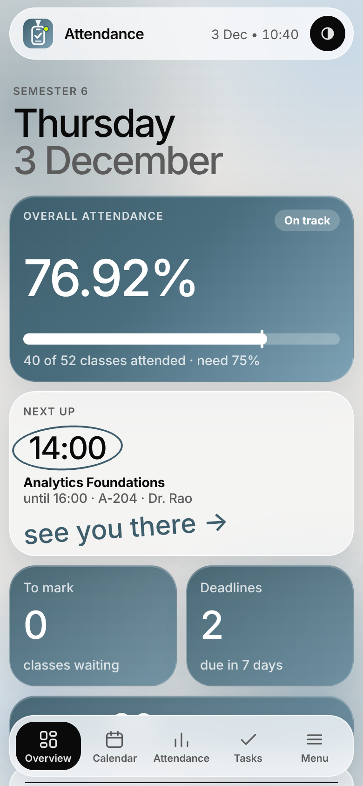
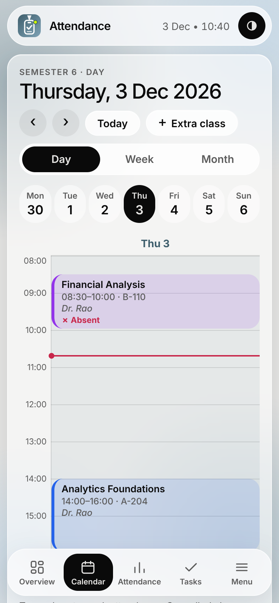
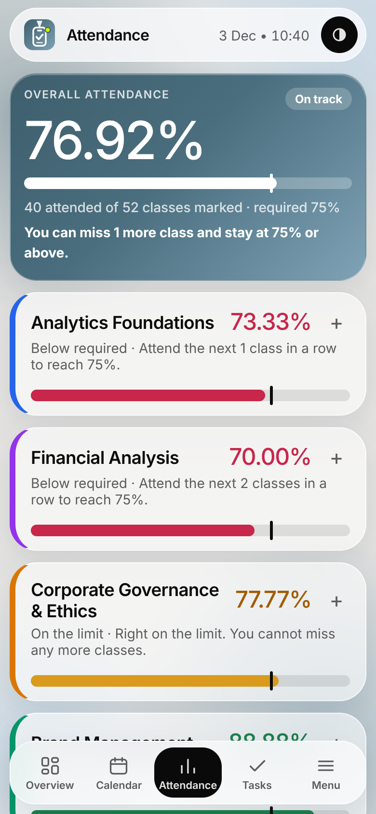
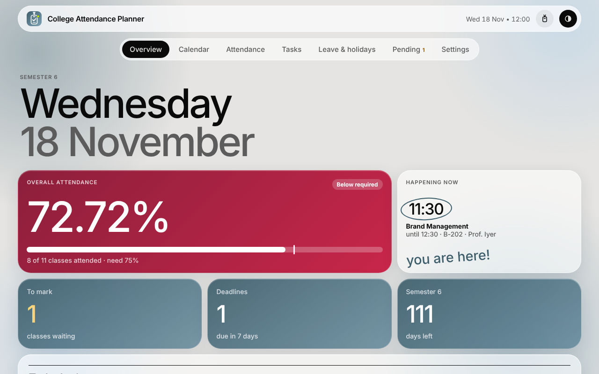
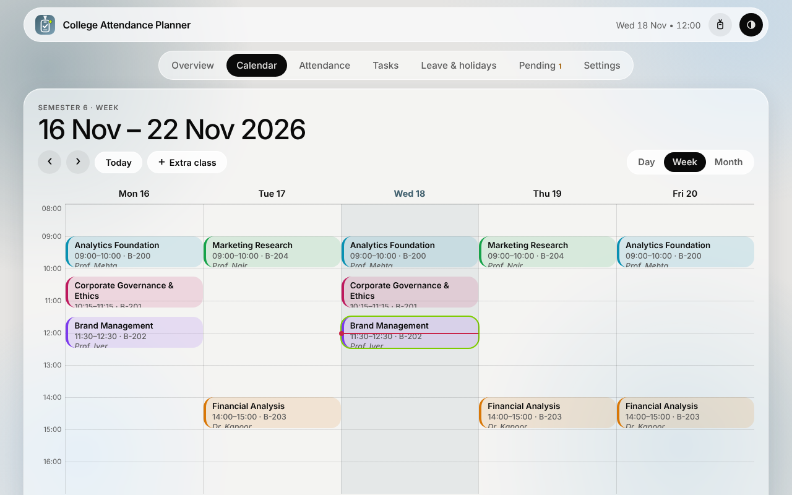
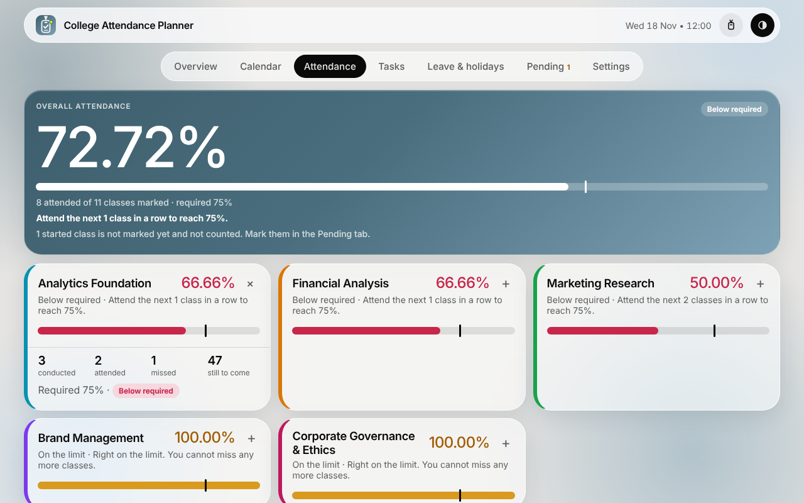
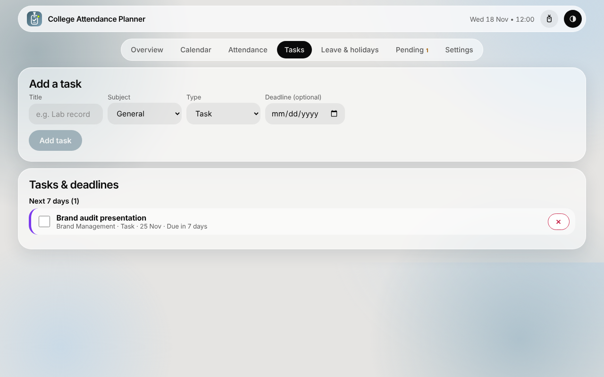
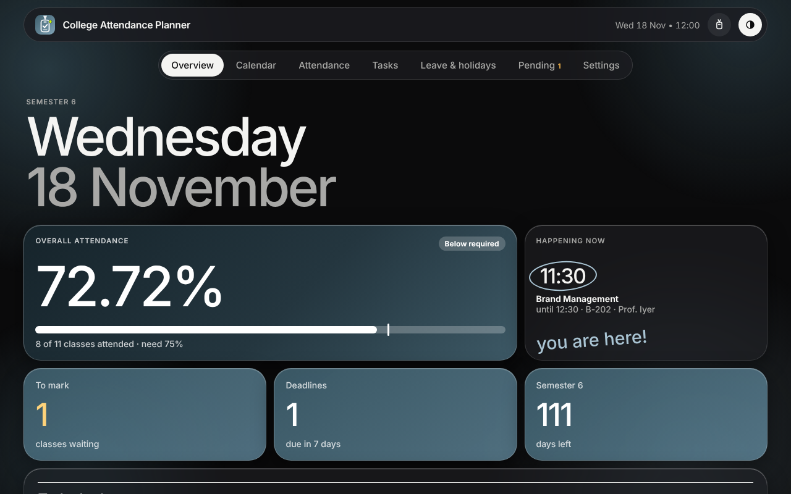
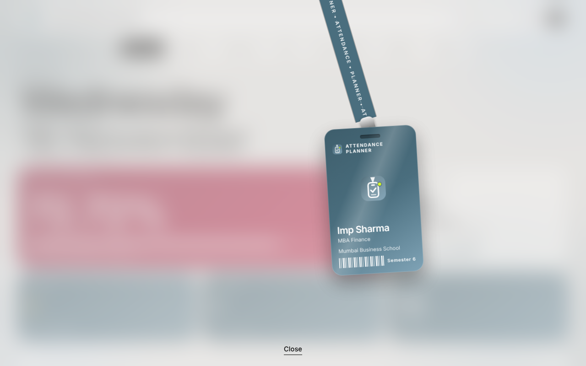

# College Attendance Planner

A personal college schedule and attendance app: calendar-first timetable,
per-subject attendance tracking, and a leave simulator that shows how a
planned holiday affects each subject before you take it.
Anyone can sign in with Google and gets their own private planner.

| Overview | Calendar | Attendance |
|---|---|---|
|  |  |  |

**On a computer**

| Overview | Calendar |
|---|---|
|  |  |

| Attendance | Tasks |
|---|---|
|  |  |

| Dark theme | Fidget ID card |
|---|---|
|  |  |

## Features
- Day / week / month calendar with subject colours
- One-way, read-only import of a Google Calendar timetable (no duplicates), or add classes by hand
- Present / absent marking, with a Pending list for missed classes
- Subject-wise attendance dashboard (percentage, classes you can still miss)
- Leave simulator that uses the real classes on the chosen dates
- Class remarks (written any time, opened with a Remarks button), tasks and deadlines, CSV export
- Experiential classes: a switch per class or per session; they count as Present automatically
- Course hours: credits per subject (4 credits = 60 hours) and a one-tap clean-up of classes above the limit
- Installable on Android as an app, works offline for reading, class reminders
- Light and dark theme
- A fidget ID card: tap the small ID button in the header to play with it (close with Close, Esc or a tap outside)
- Each person has their own data and can delete their account from Settings

## Tech stack
React + Vite, Supabase (database, Google sign-in, reminder functions), Vercel (hosting).

## Run your own copy
You need free accounts on GitHub, Supabase, Vercel and Google Cloud. Do the steps in order.

### 1. Supabase (database)
1. Create a project at supabase.com. Note the Project URL and the Publishable (anon) key under Project Settings > API.
2. Open the SQL Editor and run these files from the `supabase/` folder, one at a time, in this order:
   `phase2_schema.sql`, `phase4_attendance.sql`, `phase5b_ignored.sql`, `phase6_holidays.sql`,
   `phase7_notifications.sql`, `phase8_remarks_tasks.sql`, `phase10_profiles.sql`, `phase11_multiuser.sql`,
   `phase12_credits_experiential.sql`.
   (`phase1.sql` is not needed.) The last query shows a safety table: every row should say
   "protected by owner policy" or "locked". If any row says PROBLEM, do not share the app.

### 2. Vercel (hosting)
1. Import your GitHub copy of this repo as a new Vercel project.
2. Add environment variables (see `.env.example`): `VITE_SUPABASE_URL` and `VITE_SUPABASE_ANON_KEY`.
   Add `VITE_VAPID_PUBLIC_KEY` too if you want class reminders (step 5).
3. Deploy, and note your app address (for example `https://your-app.vercel.app`).

### 3. Google sign-in
1. In Google Cloud, create a project, enable the Google Calendar API, and set up the OAuth consent screen
   (External). Add the scope `.../auth/calendar.readonly`.
2. Create an OAuth client of type Web application. Under Authorised JavaScript origins add your Vercel address.
   Under Authorised redirect URIs add `https://YOUR_PROJECT_REF.supabase.co/auth/v1/callback`.
3. In Supabase, go to Authentication > Sign In / Providers > Google, switch it on, and paste the Client ID and Client Secret.
4. In Supabase, go to Authentication > URL Configuration. Set Site URL to your Vercel address and add
   `https://your-app.vercel.app/**` under Redirect URLs.
5. Make sure "Allow new users to sign up" is on (same Sign In / Providers page).

### 4. First sign-in
Open your app, sign in with Google and answer the short questionnaire (name, college, course, semester name and dates).
Then import your timetable from Google Calendar, or add subjects and weekly classes by hand in Settings.

### 5. Class reminders (optional)
1. Generate a notification key pair by running `npx web-push generate-vapid-keys` on your computer.
2. In Supabase > Edge Functions > Secrets add: `VAPID_PUBLIC_KEY`, `VAPID_PRIVATE_KEY`,
   `VAPID_SUBJECT` (for example `mailto:you@example.com`) and `CRON_SECRET` (any long random text).
3. Deploy the function in `supabase/functions/class-reminders/index.ts` named `class-reminders` with "Verify JWT" off.
4. Put the public key in Vercel as `VITE_VAPID_PUBLIC_KEY` and redeploy.
5. In the SQL Editor, open `supabase/phase7_schedule.sql`, replace `YOUR_PROJECT_REF` and `YOUR_CRON_SECRET`
   only inside the editor (never in GitHub), and run it.
6. In the installed app, open Settings and turn Class reminders on.

### 6. Account deletion (recommended)
Deploy `supabase/functions/delete-account/index.ts` as a function named `delete-account` with "Verify JWT" off.
Without it, the "Delete my account" button in Settings shows an error.

## Installing on a phone
Open the app address in Chrome on Android, then use the browser menu > Install app (or the install button in Settings).

## Updating
Upload changed files to GitHub. Vercel redeploys on its own. Run any new `supabase/*.sql` file once in the SQL Editor.

## More than one user
Everyone signs in with Google and gets their own timetable, attendance, tasks and settings. The database enforces this
with Row Level Security: each table only returns rows whose `user_id` is the signed-in person.
Reminders go to each person's own phone. To close sign-ups, turn off "Allow new users to sign up" in Supabase.
You can see who has signed up under Authentication > Users.

Good to know:
- Google lets an unverified app give the calendar permission to about 100 people, and everyone sees a
  "Google hasn't verified this app" screen. Signing in itself has no such limit.
- Times are India time (IST) for everyone for now.
- Reminders on Android are not 100% reliable. The Pending tab is the safety net.
- Offline: marks save on the phone and sync later; reading works only for data loaded while online.
- Calendar and leave planning read up to 1,000 sessions per page, which is fine for one semester.

## Privacy and security
No secrets are stored in this repository. Never commit the Supabase secret key, Google client secret,
VAPID private key or CRON_SECRET. All personal data lives in your own Supabase database, protected by Row Level Security.

## Licence
MIT. See `LICENSE`.
